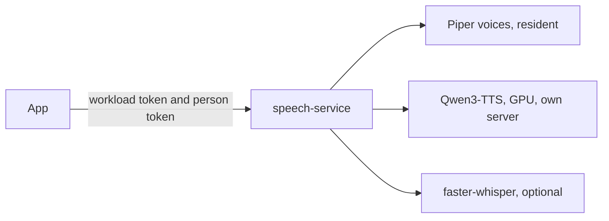

# Speech

The home server's speech service: it speaks text in the voices of a closed
catalogue and hears recordings and live audio for the apps that call it,
Presentator among them. This page is for the operator who starts and configures
it; an app developer reads [the wire](docs/wire.md).



One process offers `GET /health`, the speak route, a route that hears a
recording and a live hearing WebSocket over HTTP on a TCP address. Piper voices
are resident; a GPU voice loads on its first request, or at start with
`SPEECH_LOAD_GPU_VOICES_AT_START`; hearing is on when `SPEECH_HEARING_MODEL`
names a model. Only `/health` needs no token. The service stores nothing.

## Quick start

From the repository root, with [uv](https://docs.astral.sh/uv/):

```sh
uv sync --locked
export SPEECH_CATALOGUE_FILE=$PWD/deploy/catalogue.toml
uv run speech-fetch-voice
SPEECH_CONFIG_FILE=/absolute/path/to/speech.toml uv run speech-service
```

The catalogue file lists every voice with its pin. `speech-fetch-voice` fetches
the offered voices at their pins (`SPEECH_VOICES` narrows them); the service
itself never downloads. The service listens on `127.0.0.1:8080` and refuses to
start without the caller file; [`deploy/speech.toml`](deploy/speech.toml) shows
its keys. `uv run speech-service --help` prints usage.

- **Hearing.** `uv run speech-fetch-hearing-model large-v3`, then
  `SPEECH_HEARING_MODEL=large-v3`. On a GPU also `uv sync --locked --extra gpu`.
  `small` fits a CPU but can mishear a question; use `large-v3` where the
  meaning counts.
- **A GPU voice.** Set `SPEECH_PROVIDER_ROOT=providers`, run
  `uv sync --locked` inside `providers/qwen`, and fetch again. Qwen always runs
  on `cuda` and reserves 0.45 of the card.
- **A container.** `Dockerfile` and `compose.yaml` run the small image: CPU,
  the Piper voices and `small`, all baked in at build.

## The GPU image

Every release publishes `ghcr.io/overnightworks/speech:<version>` (small) and
`:<version>-gpu` (`docker build --target gpu .`), which bakes every catalogue
voice and large-v3, loads Qwen and large-v3 at start and hears on `cuda`. It is
configured like the small image; what differs:

- **One GPU**, not shared by assumption. With large-v3 beside Qwen the card
  held 13.2 GB on an RTX 3090; the service and Qwen server peaked at 12.7 GB of
  host memory.
- **`/dev/shm`** above Docker's 64 MB default (`--shm-size` or `--ipc=host`):
  the server's stages pass data through it. **`/tmp`** writable for its compile
  caches.
- **Startup probe.** `/health` answers while models load, with `ready` false.
  Qwen took about 5 minutes and large-v3 under 10 seconds; probe until
  `speaking.ready` and `hearing.ready` are true and allow 10 minutes, the
  server's 600 seconds, after which the process ends.

## Models

| Role | Model | Licence |
| --- | --- | --- |
| Piper, German | [`rhasspy/piper-voices`](https://huggingface.co/rhasspy/piper-voices) `de_DE-thorsten-medium` | Recordings CC0; weights under the piper-voices MIT repository; the `piper-tts` runtime is `GPL-3.0-or-later` |
| Piper, German | `de_DE-kerstin-medium` | Dataset CC0; fine-tuned from Hi-Fi TTS, CC BY 4.0 (NVIDIA), which needs credit |
| Piper, English | `en_US-norman-medium`, `en_US-ljspeech-medium`, `en_GB-cori-medium` | Public domain per each model card |
| Speaking, optional | [`Qwen/Qwen3-TTS-12Hz-1.7B-CustomVoice`](https://huggingface.co/Qwen/Qwen3-TTS-12Hz-1.7B-CustomVoice), speaker `ryan`, German and English | Apache-2.0 |
| Voice design, offline | [`Qwen/Qwen3-TTS-12Hz-1.7B-VoiceDesign`](https://huggingface.co/Qwen/Qwen3-TTS-12Hz-1.7B-VoiceDesign); not part of the service | Apache-2.0 |
| Hearing, optional | [`Systran/faster-whisper-large-v3`](https://huggingface.co/Systran/faster-whisper-large-v3), [`-small`](https://huggingface.co/Systran/faster-whisper-small) | MIT |

Each model is pinned to a revision. `speech-qwen-design-voice` (installed with
`providers/qwen`, GPU host) renders candidate voices from a description; see
`--help` for its arguments.

## Settings

Every setting is read from `SPEECH_*` in the environment. The wire's settings
(offered voices, waits and limits, hearing model, live silence, caller file) are
in [`docs/wire.md`](docs/wire.md#settings-that-shape-the-wire). The process's
own:

| Variable | Default | Meaning |
| --- | --- | --- |
| `SPEECH_HOST` | `127.0.0.1` | Address the listener binds; a container sets `0.0.0.0` |
| `SPEECH_PORT` | `8080` | TCP port |
| `SPEECH_DEVICE` | `cuda` | Hearing's device, `cuda` or `cpu`; Piper stays on the CPU, Qwen on `cuda` |
| `SPEECH_CATALOGUE_FILE` | none, required | Absolute path of [`deploy/catalogue.toml`](deploy/catalogue.toml); the images set it |
| `SPEECH_VOICE_CACHE` | `~/.cache/piper` | Where Piper's files are kept and fetched to |
| `SPEECH_HUGGINGFACE_CACHE` | the Hub cache | Where hearing's and Qwen's files are kept and fetched to |
| `SPEECH_PROVIDER_ROOT` | none | Directory of the provider environments; a GPU voice needs it, and with it the default offer holds every catalogue voice |
| `SPEECH_LOAD_GPU_VOICES_AT_START` | `false` | `true` loads every offered GPU voice at start and holds `/health` not ready until then |
| `LOG_LEVEL` | `info` | `debug` to `critical`; a malformed value stops the start |
| `SERVICE_VERSION` | none | The `version` of every log line |

## Install as a dependency

Three Python distributions and the browser package are released together at one
version, as the Git tag `vX.Y.Z`, and go to no registry. A host pins each by Git:

```text
overnightworks-speech-client @ git+https://github.com/overnightworks/speech@vX.Y.Z#subdirectory=packages/client
overnightworks-speech-provider-contract @ git+https://github.com/overnightworks/speech@vX.Y.Z#subdirectory=providers/provider-contract
overnightworks-speech-service @ git+https://github.com/overnightworks/speech@vX.Y.Z
```

The host also pins each dependency a distribution declares by name only, as the
release notes list it. The service pin installs the CPU path; GPU hearing needs
`[gpu]`. The browser package is the release file
`https://github.com/overnightworks/speech/releases/download/vX.Y.Z/overnightworks-speech-browser-X.Y.Z.tgz`;
the release notes give the `sha512-` integrity for the lockfile.

The client (`packages/client`) carries the wire's types and the calls an app
makes: speaking, with or without a voice preference, the health fetch, the live
hearing session, the relay of a browser's audio to it and the finished
utterances. The browser package (`packages/browser`) captures an app's own
microphone stream and plays sounds on its page. The app keeps the routes and the
tokens; none reaches the browser. Each module documents its calls.
`scripts/check_release.py` holds all four at one version.

## Release

The operator releases by dispatching a workflow with a version; his yes covers
whatever `main` holds at the dispatch, and release tags are his:

```sh
gh workflow run release.yml -f version=YYYY.MM.DD.N
gh workflow run release-distributions.yml -f version=X.Y.Z
```

`release.yml` builds, attests and pushes the gpu image, then the small one, and
sets the dated tag `vYYYY.MM.DD.N`. `release-distributions.yml` releases the
three distributions and the browser package at one `X.Y.Z`. Both run quality's
release gate, described in
[quality's `docs/release.md`](https://github.com/overnightworks/quality/blob/2d2b68bf3916b34f6f2c72a540c1e3d8a947b750/docs/release.md).

If the small image fails after the gpu image was pushed, re-run the failed jobs
(`gh run rerun <run-id> --failed`): it builds the small image and sets the tag.

## Proofs

Each proof re-runs itself under `probe-run`, uses a free port and its own names,
and cleans up what it started:

| Command | What it proves |
| --- | --- |
| `uv run python scripts/prove_speech.py` | Health and speaking of every offered Piper voice and two at once, ending in `PROOF_OK`; with a hearing model, a recording heard meanwhile. Without a card: `SPEECH_DEVICE=cpu` |
| `uv run python scripts/prove_hearing.py --device cpu --hearing-model small --record record.json --english-voice-directory ~/.cache/piper-en` | Hearing, live and from a file; only a record with an empty `not_measured` is `complete` |
| `uv run python scripts/prove_image.py` | The built image under the real `compose.yaml` (CI job `Speech: image`) |

## Documentation

- [`docs/wire.md`](docs/wire.md): the speak, hearing and health wire, its refusals and settings, for an app developer.
- [`docs/ARCHITECTURE.md`](docs/ARCHITECTURE.md): the parts, the trust and the delivery, for an engineer changing the service.
- [`docs/VISION.md`](docs/VISION.md): what the service is for.
- [`AGENTS.md`](AGENTS.md): commands and checks, for agents.

Licence: [MIT](LICENSE).
