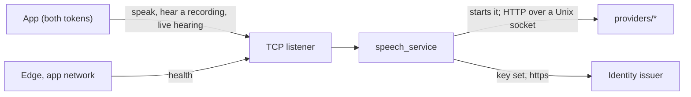
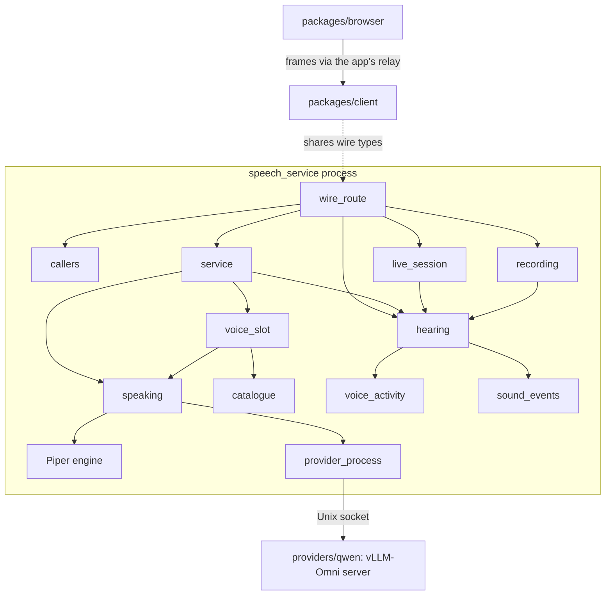
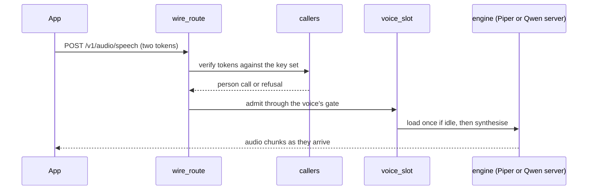

# Architecture

Reader: an engineer changing a building block, the trust model or delivery.
[`README.md`](../README.md) starts the service, [`wire.md`](wire.md) owns the
wire and its settings, [`VISION.md`](VISION.md) its purpose.

## Context and Scope

One process on the home server keeps the Piper voices and, if named, a hearing
model resident, runs each GPU voice in a child server, and serves them to apps
that speak or have audio heard for a person. It stores nothing.

## Building Block View

- `src/speech_service`: `catalogue.py` loads `deploy/catalogue.toml` into typed
  records; `voice_slot.py` owns a voice's load job and `AdmissionGate`;
  `callers.py` decides who may call; `wire_route.py` serves the wire;
  `hearing.py` holds the engine, the language identifier (behind its own port),
  the gate and the one submission worker; `live_session.py` is a live socket's
  state machine, `hearing_session.py` schedules its turns, `voice_activity.py` the streaming Silero VAD;
  `sound_events.py` runs the sound model on its own worker and owns which AudioSet labels
  make which sound.
- `packages/client` owns the wire's types and the app's calls, `relay` among
  them. `packages/browser` captures and plays audio on an app's page; its
  `hop.ts` is generated by `scripts/generate_browser_wire.py`.
- `providers/*`: voices in their own uv projects with their own locks; the
  shared source is `providers/provider-contract`. Qwen's launcher is the
  service's direct child and runs vLLM-Omni's server as its own child; both stay
  in the launcher's process group.
- `Dockerfile`, `compose.yaml`, `deploy/`: the images, see Deployment View.

## Runtime View

A speak request: the caller check comes first, the voice's gate admits it, and
audio streams as the engine renders it.

Live hearing is one state machine per socket: receiving never waits for a
decode, and one worker decodes. Its rules are in [wire.md](wire.md#hearing-live).
A session that asks for sounds also has its audio scored on a second worker, so
sounds never wait for a decode nor a decode for sounds.

## Deployment View

The release builds, attests and pushes two images to GHCR, the gpu one first.
hal builds its own small image from the dated tag, so the tag fixes the code,
locked dependencies, voices, hearing model, catalogue and caller table. Nothing
is fetched at start: shipped commands fetch voices and models at pinned
revisions, and the service has no route to a registry or hub.

- The small image has the Piper voices and hears with `small` on the CPU. Its
  healthcheck requires Piper and hearing ready; Qwen offered on it is refused
  `unavailable` and `/health` reports it not ready.
- The gpu image offers every catalogue voice, bakes Qwen's weights and
  large-v3, and loads both at start. Qwen's environment is uv-managed CPython
  3.12 (vLLM-Omni caps below the service's 3.14) beside CUDA 12 libraries and a
  C compiler for Triton. Too large for a standard runner's disk, it is built on
  `speech-gpu-build`.
- Both images carry the sound model, `frame_mn10` as ONNX, in `/opt/sound-model`.
  A build-only stage converts it: wheel-only packages from the lock of
  `scripts/build_sound_model.py` (hashed, `--locked`), PretrainedSED's source and
  checkpoint each fetched at a pinned sha256, and the ONNX held to the PyTorch
  model on seeded noise and a CC0 clip before anything is written. The images
  take only the ONNX, its labels and the upstream `LICENSE` from that stage:
  its torch stays there, whatever torch the GPU image's Qwen environment brings.
- The service sits on external and internal networks, never a default one; an
  absent network stops the start, so a run has no egress. The root is
  read-only, the user not root, no capability kept.
- One instance serves one address and one device; the platform starts one per card.
- On SIGTERM or SIGINT the service reports not ready, refuses new work and
  drains, bounded as [wire.md](wire.md#hearing-live) (WIRE-147) states. Each of
  the five close steps in `__main__.py` has a 5 s grace, then the process exits
  0. A pod's grace period covers the drain, the graces and the balancer's
  leaving; a replacement starts before the old pod stops.

## Crosscutting Concepts

### Trust

- Keycloak is the root; a registered app with valid tokens is trusted within its
  config, and can only slow another, bounded by the busy wait and input limit (WIRE-160).
- Every capability passes the caller check. Only `GET /health` and the refusals
  that carry no capability (404 `not_found`, 400 `unsupported_version`) answer
  before it. `/health` is reachable only inside edge's app network: the code
  binds `127.0.0.1` and the deployment sets `SPEECH_HOST`.
- Webauth verifies both tokens against the issuer's key set. The workload token
  carries the realm role of a registered app's client; the person's token names
  another subject in the app's group and the service group. A call an app makes
  as itself is refused. Issuer, group and apps are configuration
  (`SPEECH_CONFIG_FILE`); a refusal never names the failed token or claim.
- The process sets `ORT_DISABLE_TELEMETRY=1` unless the environment names a value,
  so onnxruntime's built-in telemetry opens no connection.
- No token, subject or key-set address reaches a log, an error or a repr, and
  no spoken or heard text reaches a log.
- Qwen's server is reachable only through a Unix socket in a private 0700
  directory with a fresh path per start, so no port opens and a stale server is
  never mistaken for the new one. It sends no telemetry, runs offline from a
  pinned snapshot with no Python file. The launcher's parent-death signal ends
  the server's whole process group, stages included, when the service dies. The
  launcher clears wake directories a killed server left in `/dev/shm`, never
  following a link.
- The browser hop of the client's relay belongs to the app. The browser package
  holds no token, interprets no message and opens no device (the app grants the
  microphone in its `Permissions-Policy`); its frames are untrusted and bounded.
  The app serves the capture worklet and hands the player its URL, same-origin;
  webauth's `script-src 'self'` and `connect-src 'self'` admit both.

### Logging

Every line is logline's JSON record under the service name `speech`, with closed
codes on failure; a provider's stderr tail (at most 64 KiB) is logged once, with
the load's failure. Nothing is written per chunk.

### Failure isolation

A failed load, missing files or a crashed Qwen server make that voice refuse 503
`unavailable` and report not ready while the others keep serving; the next
request loads it again. A server that cannot be reaped ends the process. A
hearing load that fails for want of a resource leaves the process up with
hearing not ready; a misconfiguration stops the start naming the setting.

### Proof strategy

Tests beside the code drive real entry points, the README's proof scripts and
Chromium browser flows prove the rest. A GPU voice is proven in CI with a fake
launcher; the image's speaking and hearing on the card by a GPU run.

## Constraints and reasons

- **The operator owns the card.** The service arbitrates nothing; `SPEECH_VOICES`
  is his switch, and a loaded GPU voice keeps the card until the process ends.
- **The service never downloads**, so the dated tag fixes what runs and the
  container needs no egress.
- **A replica holds connections only**: a live session stays on the process that
  serves its socket and is drained on a stop, so replicas need no sticky routing.
- **Speaking and hearing are separate admission resources**, each with its own
  gate, so a busy synthesis never refuses a recording nor a busy decode a speak
  request. A lease is given back only when the native call returns, because
  CTranslate2 cannot be interrupted.
- **A shared load is never cancelled by a leaving request**, and an engine is
  closed only off the event loop, so a retry starts only once no server of that
  voice remains.
- **Hearing is deterministic and local.** faster-whisper decodes greedily from
  the pinned snapshot; turns start and end on Silero VAD, not loudness, and the
  language choice sits behind a port the session and decode never see.
- **Sound events are opt-in per session**, so a client that does not ask sees the
  wire it saw before; `SPEECH_SOUND_EVENTS=false` loads no model at all. The label
  mapping, Applause folded into Clapping included, is the service's own.
- **Piper's marks come from its own espeak-ng** (ctypes, after each sentence's
  audio left), as piper-tts has no API for text positions; a failed load check
  switches them off.
- **Piper is resident and on the CPU**, so a taken card never silences speaking
  and a failed Piper load ends the process. With hearing on `cpu`, speaking and
  hearing share the CPU.

## Not chosen

- **Kokoro-German:** no documented German; reopens when German is trained.
- **XTTS-v2 and forks:** the Coqui licence excludes commercial use; reopens on a
  permissive licence.
- **Orpheus (`Thorsten-Voice/tv-orpheus-v1`):** a 3B talker, first audio never
  measured here; reopens when measured inside the one-second target.
- **Engines as their own pods:** a sidecar leaves the private directory and the
  caller check; reopens when the GPU engine must roll alone or a second card exists.
- **Chatterbox, Magpie, VoxCPM:** each GPU voice costs its own environment,
  weights and card proof; reopens when the operator names one.
- **Piper `thorsten-high`:** first audio over the one-second target; reopens if
  the target moves.
- **Arbitrating the card:** reopens with a second card or platform reservation.

## Risks and Technical Debt

- The platform moves to k3s and Flux, which replace Compose and hal. Until then
  `compose.yaml` runs the service, naming no GPU voice and reserving no card.
- Qwen's first audio can outlast `SPEECH_BUSY_WAIT_SECONDS`, so a second request
  may answer `busy` meanwhile. Without the start setting the first request also
  waits about five minutes for the server to load.
- The service imports `piper-tts`, which is `GPL-3.0-or-later`, in an MIT
  repository; the obligation that follows is not settled here.
- The sound model's weights are trained on AudioSet. PretrainedSED's code is
  MIT and its author permits the checkpoints' use in applications, but the
  training data's terms are not settled here, as with Piper's GPL.
- Loudspeaker echo can raise a sound, as it can hold a speaking agent; it is
  judged in use. The cost of scoring beside a decode, about 4.5 % of one core per
  session, is not judged under load.
- Neither Dependabot nor the quality gate's advisory scan reads the inline
  header or the lock of `scripts/build_sound_model.py`, so its pins move by hand
  and its packages are not scanned for advisories.
- A copied token works until its `exp`, with no leeway or sender constraint. A
  live hearing session outlives a token's expiry; the app ends it.
