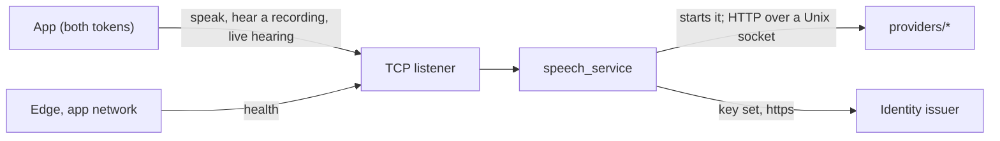
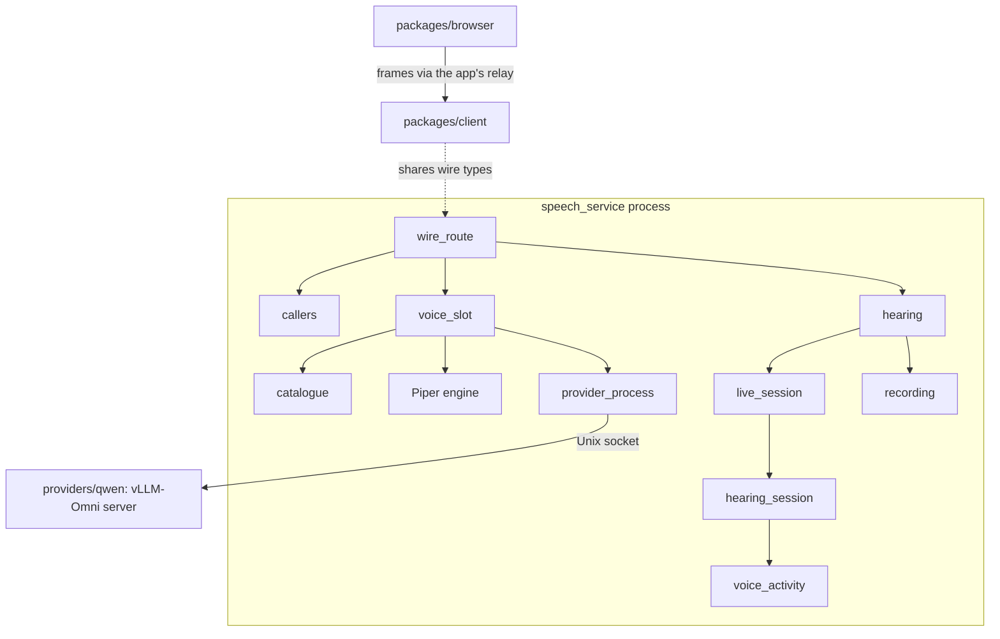
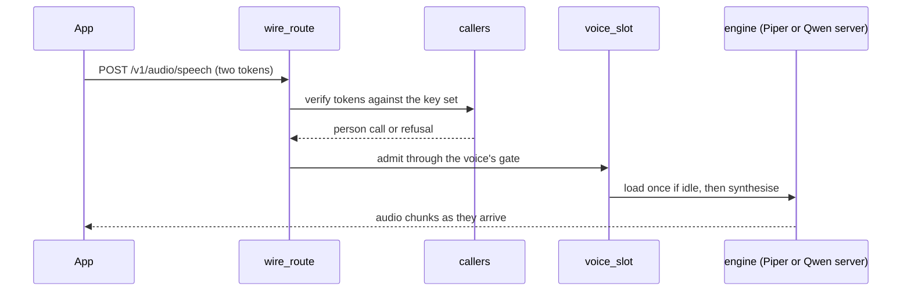

# Architecture

Reader: an engineer changing a building block, the trust model or delivery.
[`README.md`](../README.md) starts the service, [`wire.md`](wire.md) owns the
wire and its settings, [`VISION.md`](VISION.md) its purpose.

## Context and Scope

One process on the home server keeps the Piper voices and, if named, a hearing
model resident, runs each GPU voice in a child server, and serves them to apps
that speak or have audio heard for a person. It stores nothing.

## Building Block View

- `src/speech_service`: `catalogue.py` loads `deploy/catalogue.toml` into typed
  records and holds each engine's facts; `voice_slot.py` owns one voice's load
  job and its `AdmissionGate`; `callers.py` decides who may call;
  `wire_route.py` serves the wire; `hearing.py` holds the engine, the language
  identifier (behind its own port), the gate and the one submission worker;
  `live_session.py` is a live socket's state machine, `hearing_session.py`
  schedules its turns from a speech detector, `voice_activity.py` is the
  streaming Silero VAD; `clock.py` is the monotonic clock every gate deadline
  reads.
- `packages/client` owns the wire's types (`speech_client.wire`) and the calls
  an app makes, among them `relay`, which forwards a browser socket to a hearing
  session. `packages/browser` captures and plays audio on an app's page; its
  `hop.ts` is generated from `PcmFormat` and `speech_client.relay` by
  `scripts/generate_browser_wire.py`.
- `providers/*`: voices in their own uv projects with their own locks;
  `providers/provider-contract` is the shared source. Qwen's is a launcher the
  service starts as its child, which becomes vLLM-Omni's server.
- `Dockerfile`, `compose.yaml`, `deploy/`: the images, see Deployment View.

## Runtime View

A speak request: the caller check precedes everything, the voice's own gate
admits it, and audio streams as the engine renders it.

Live hearing is one state machine per socket: receiving never waits for a
decode, audio becomes turns on Silero speech and silence, and one worker decodes.
Its turn, final and drain rules are in [wire.md](wire.md#hearing-live).

## Deployment View

The release builds, attests and pushes two images to GHCR, the gpu one first.
hal builds its own small image from the dated tag, so the tag fixes the code,
locked dependencies, voices, hearing model, catalogue and caller table. Nothing
is fetched at start: shipped commands fetch voices and models at pinned
revisions, and the service has no route to a registry or hub.

- The small image has the Piper voices and hears with `small` on the CPU. Its
  healthcheck requires Piper and hearing to be ready. Qwen offered on it is not
  installed: requests are refused `unavailable`, `/health` reports it not ready,
  Piper and hearing keep serving.
- The gpu image offers every catalogue voice, bakes Qwen's weights and
  large-v3, loads both at start and hears on `cuda`. Qwen's environment is
  uv-managed CPython 3.12 (vLLM-Omni caps below the service's 3.14) beside the
  service's CUDA 12 libraries, and a C compiler with headers for Triton. It is
  too large for a standard runner's disk, so its release job and the CI build
  of a change to the `Dockerfile`, a `uv.lock` or `providers/` run on
  `speech-gpu-build`.
- The service sits on external, internal networks and no default one: one
  shared with the gateway that carries the key set, one per app on hal's
  Compose path. An absent network stops the start, so a run has no egress. The
  root is read-only, the user not root, no capability kept.
- One instance serves one address and one device; the platform starts one per
  card and decides which workload holds it.
- The service owns the stop signal. On SIGTERM or SIGINT it reports not ready
  and refuses new work, ends live sessions at turn boundaries, shuts the server
  down waiting for running streams and recordings, then closes the engines. The
  drain is bounded by 30 s plus `SPEECH_HEARING_FINAL_WAIT_SECONDS` (90 s by
  default); past it the server cuts what runs and each of five close steps has a
  5 s grace, after which the process ends with exit 0. A pod's grace period must
  cover the drain, the five graces and its endpoint's leaving the balancer, and
  a replacement must start before the old pod stops.

## Crosscutting Concepts

### Trust

- Keycloak is the root. A registered app with valid tokens is trusted within its
  config; one app can only slow another, bounded by the busy wait and the input
  limit.
- Every capability passes the caller check. Only `GET /health` and the refusals
  that carry no capability (404 `not_found`, 400 `unsupported_version`) answer
  before it. `/health` is reachable only inside edge's app network: the code
  binds `127.0.0.1` and the deployment sets `SPEECH_HOST`.
- Both tokens are verified by webauth against the issuer's key set; the
  workload token carries the realm role from a registered app's client; the
  person's token comes from the same client, names another subject and belongs
  to the app's group and to the service group. A call an app makes as itself is
  refused. Issuer, group and apps are configuration (`SPEECH_CONFIG_FILE`). A
  refusal never says which token or claim failed beyond its code.
- No token, subject or key-set address reaches a log, an error or a repr, and
  no spoken or heard text reaches a log.
- Qwen's server is the service's child, reachable only through a Unix socket in
  a private 0700 directory with a fresh path per start, so no port opens and a
  stale server is never mistaken for the new one. It sends no telemetry,
  compiles nothing with `nvcc` (the image has none), and has `/dev/null` for
  stdin and stdout and a drained pipe for stderr. It dies with the service (the
  parent-death signal, kept across the launcher's `exec`) and has its own
  process group, so a stop ends every stage. The launcher clears the wake
  directories a killed server left in `/dev/shm`, never following a link. The
  pinned snapshot holds no Python file and the process runs offline, so
  `trust_remote_code` has nothing to fetch.
- The browser hop of the client's relay belongs to the app: its frames are
  untrusted and bounded, admission is the app's, and the tokens stay on the
  app's server. The browser package holds no token, interprets no message, opens
  no device (the app grants the microphone in its `Permissions-Policy`) and
  fetches only the URL the app hands it, with default same-origin credentials,
  which webauth's `script-src 'self'` and `connect-src 'self'` admit.

### Logging

Every line is logline's JSON record under the service name `speech`. Failure
lines carry closed codes and numbers; a provider's stderr tail (at most 64 KiB)
before ready reaches the log once with the load's failure. Nothing is written
per chunk or frame. Events and fields are owned by the code that writes them.

### Failure isolation

A failed load, missing files or a crashed Qwen server make that voice refuse 503
`unavailable` and report not ready while the others keep serving; the next
request loads it again. A server that cannot be reaped ends the process. A
hearing load that fails for want of a resource (no CUDA device, a full card)
leaves the process up with hearing not ready; a misconfiguration (a model not
fetched, a malformed setting) stops the start naming the setting.
`/health` and the refusal read one readiness answer.

### Proof strategy

Behaviour is proven by tests beside the code through real entry points, by the
proof scripts in the README, and by browser flows in Chromium. A GPU voice is
proven in CI with a fake launcher that serves the server's HTTP; CI builds and
proves the small image and builds the gpu stage without pushing it, and the
built image's speaking and hearing on the card are proven by a GPU run.

## Constraints and reasons

- **The operator owns the card.** The service arbitrates nothing; `SPEECH_VOICES`
  is his switch, and a loaded GPU voice keeps the card until the process ends.
- **The service never downloads**, so the dated tag fixes what runs and the
  container needs no egress.
- **A replica holds connections only.** A live session lives on the process that
  serves its socket and is drained on a stop; a client closed `1012` opens a new
  session on any replica. Nothing outlives a session, so replicas share no store
  and need no sticky routing.
- **Speaking and hearing are separate admission resources**, each with its own
  gate, so a busy synthesis never refuses a recording nor a busy decode a speak
  request, and one GPU synthesis never makes a Piper voice `busy`. A lease is
  given back only when the native call returns, because CTranslate2 cannot be
  interrupted.
- **A shared load is never cancelled by a leaving request**, and an engine is
  closed only off the event loop, so a retry starts only once no server of that
  voice remains.
- **Hearing is deterministic and local.** faster-whisper decodes greedily from
  the pinned snapshot with `local_files_only`; turns start and end on Silero VAD,
  not loudness, and the language choice is its own step behind a port, so the
  session, the wire and the decode never see which identifier runs.
- **Piper's words and sounds come from its own espeak-ng.** piper-tts has no API
  for text positions, so `espeak_marks.py` reads espeak-ng's events through
  ctypes after each sentence's audio left, never delaying the first audio. It
  rests on one build of that library: a load check of version, lock and a known
  text switches the marks off with one error line per voice while audio keeps
  playing; a test against the locked wheel fails when a bump changes it.
- **Piper is resident and on the CPU**, so a taken card never silences speaking
  and a failed Piper load ends the process. With hearing on `cpu`, speaking and
  hearing share the CPU.

## Not chosen

- **Kokoro-German:** the official Kokoro has no documented German and the
  community fine-tune warns it is undertrained; reopens when German is trained.
- **XTTS-v2 and its forks:** the Coqui Public Model License excludes commercial
  use; reopens if the weights get a permissive licence.
- **Orpheus (`Thorsten-Voice/tv-orpheus-v1`):** a 3B talker of about 8 GB, its
  first audio never measured here; reopens when it is measured inside the
  one-second target.
- **Engines as their own pods:** a sidecar would leave the service's private
  directory and caller check and change ruled loading at start; reopens when the
  operator wants the GPU engine rolled independently, the platform's rollout
  rule demands it, or a second card or GPU sharing exists.
- **Chatterbox, Magpie and VoxCPM:** each GPU voice costs its own environment,
  weights and card proof; reopens when the operator names a voice he wants.
- **Piper `thorsten-high`:** its first audio was over the one-second target;
  reopens if the target moves.
- **Freeing a GPU voice or arbitrating the card in the service:** the operator
  turns a voice off in the setting; reopens when he forgets that often, with a
  second card or a platform-level reservation.

## Risks and Technical Debt

- The platform moves to k3s and Flux, which replace Compose and hal. Until then
  `compose.yaml` runs the service, naming no GPU voice and reserving no card:
  it speaks with Piper and hears on the CPU.
- Qwen's first audio can outlast `SPEECH_BUSY_WAIT_SECONDS`, so a second request
  for it may answer `busy` while one long sentence runs. Without the start
  setting the first request also waits for the server to load, about five
  minutes.
- Speaking and hearing share the CPU when hearing runs on `cpu`. On a shared
  development machine (CPU, `small`, four Piper voices) one voice's first audio
  took 0.21 to 0.24 s, two at once 0.33 to 0.45 s, and a recording heard while
  two voices speak 4.1 to 5.4 s; `scripts/prove_speech.py` re-measures it.
- The service imports `piper-tts`, which is `GPL-3.0-or-later`, in an MIT
  repository; the obligation that follows is not settled here.
- A copied token works until its `exp`, with no leeway, and carries no sender
  constraint. The service does not end a live hearing session when a token
  expires or the person loses the right, so the app ends a hearing when its
  right to hear ends.
